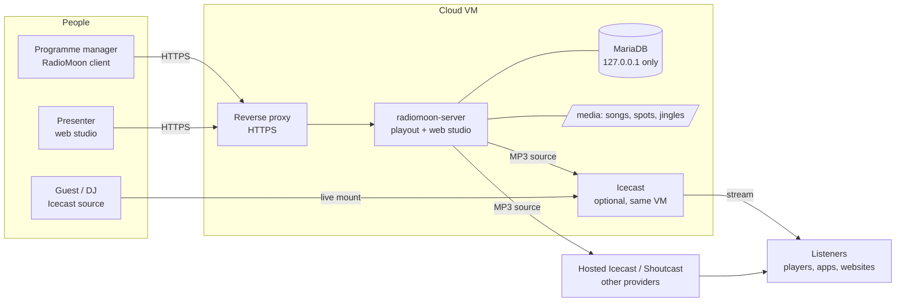

# Cloud Hosting Design

How to run a radio station on a server in the cloud with RadioMoon: the playout, the library and the internet broadcast are on the server, the people work from anywhere.


## 1. The idea

A desktop automation needs a PC in the studio with a sound card. In the cloud the **server edition** does the same job without a screen and without a sound card:

- it plays the songs, jingles and spots by the schedule, mixes them and **sends the mix to the internet** (Icecast / Shoutcast);
- the library (database and audio files) lives on the server;
- presenters and managers work with the **web studio** or the **RadioMoon client**; closing them never stops the broadcast.

Everything below can run in containers: see [[Docker]].

## 2. Reference design



| Part | Job | Notes |
|---|---|---|
| `radiomoon-server` | playout, schedule, mixing, MP3 encoding, web studio, API for the client | one process per station; a watchdog restarts it if its main loop stops |
| MariaDB | libraries, schedules, users, settings, history | installed by `install.sh`, listens on `127.0.0.1` only |
| `media` folder | the audio files (`songs`, `spots`, `jingles`, `assets`, `sweepers`, `voice`) | under `/var/lib/radiomoon` |
| Reverse proxy | HTTPS in front of the web port | RadioMoon itself speaks plain HTTP |
| Streaming server | holds the listeners | your own Icecast, or a hosted Icecast / Shoutcast |

## 3. What the server does for light traffic

The client of a cloud server sends commands and receives state. The heavy work stays on the server: the **waveform** (the client gets some KB), **auto cue**, **tag reading** and **normalize**. A song is downloaded only when somebody previews it, into a cache that cleans itself. A low-bandwidth mode exists for weak connections. So a studio on a slow link can still work with a big library.

## 4. Sizing

RadioMoon does not need a big machine; the numbers that matter:

| What | Rule |
|---|---|
| **CPU** | the mixer plus **one MP3 encoder for every server entry** of Internet broadcast. Start with 2 vCPU for a station with up to a few outputs, and watch the load. |
| **RAM** | MariaDB is tuned by the installer to a quarter of the RAM (128 MB to 1 GB for its buffer); 1 GB is the practical minimum for a small library, 2 GB or more for a big one. |
| **Upstream bandwidth** | bitrate × number of stream servers. 128 kbps = 16 kB/s = **about 58 MB per hour, 1.4 GB per day** for one output. Two outputs: double. The listeners do **not** use this link if the streaming server is somewhere else (or if Icecast on the same VM is used, its listeners do). |
| **Disk** | the songs (a typical MP3 is 3 to 10 MB: 10 000 songs is 30 to 100 GB), plus backups of the database (small, without audio). |
| **Listeners** | live on the streaming server: each listener at 128 kbps is 16 kB/s from the Icecast machine. 1000 listeners = 16 MB/s = 128 Mbit/s. Put Icecast on a machine (or a provider) with the bandwidth, or use relays. See [[Internet Radio Design]]. |

## 5. Network and security

RadioMoon opens **one port**: the web port, `8080` by default (the web studio, the API and the database tunnel of the client).

1. **HTTPS.** The port is plain HTTP and the sign-in uses Basic credentials, so on the internet **always put it behind a reverse proxy with a certificate** (Caddy, nginx, Traefik) and bind RadioMoon to the local side:
   ```
   RADIOMOON_BIND=127.0.0.1:8080
   ```
   Example with Caddy (automatic certificate):
   ```
   radio.example.com {
       reverse_proxy 127.0.0.1:8080
   }
   ```
   In the client enter `https://radio.example.com`. Allow large uploads in the proxy (songs are uploaded through it) and long reads.
2. **Two-step login** for every user, at least for administrators: [[Users and Two-step Login]]. Use strong passwords; change the web password in `webserver.json` if you want a different one.
3. **Firewall / security group:** open 443 (and 80 for the certificate) to the world, nothing else. SSH only from your addresses. The database (3306) stays closed: the installer binds it to `127.0.0.1`.
4. **The database user** `radiomoon` has a default password because the database is reachable only from the machine itself; change it if the machine has other users (`ALTER USER`, then `radiomoon-server --setup --db-password ...`).
5. **The service user:** the server runs as the system user `radiomoon`, not root. Its program folder belongs to it so that [[the server can update itself|Updating]].
6. **Users and permissions:** give presenters only the permissions they need.

## 6. Running it

- **Backups.** The server makes a daily backup of the database on its own disk (**Backup & restore**). That is not enough in the cloud: add **snapshots** of the machine from your provider and a **copy of `media` and `backups`** to another place (object storage, another server) with `rsync` or `rclone`. The backup file has no audio.
- **Updates.** From the web studio or the client (**Update**); the database is upgraded with a backup. Do it at a quiet hour: the broadcast stops for a moment. [[Updating]]
- **Monitoring.** The header of the studio shows the listeners; the web studio shows the stream status; the logs are in `journalctl -u radiomoon-server` (or `/var/log/radiomoon-server.log` on Alpine). An external check of `https://radio.example.com/` or of the stream URL tells you if it is down.
- **After a restart** of the server: the service starts by itself and the streams marked *start automatically* connect again; users sign in again.

## 7. Moving in

| From | How |
|---|---|
| A RadioMoon desktop station | [[Move to a Server]]: database and songs in one step |
| Jazler RadioStar 2, MegaMix | [[Import from Jazler]] with *upload the files to the server* |
| Files only | Import the folders from the client: they are uploaded to the server |

## 8. What it does not do (yet)

- No built-in HTTPS: use a reverse proxy.
- One server process is **one station**. Hosting many stations is done with one process per station: [[Hosting Several Stations]].
- No central control panel or billing for many stations; each has its own web studio.
- The sound card output on the server is optional; a cloud machine has none.
