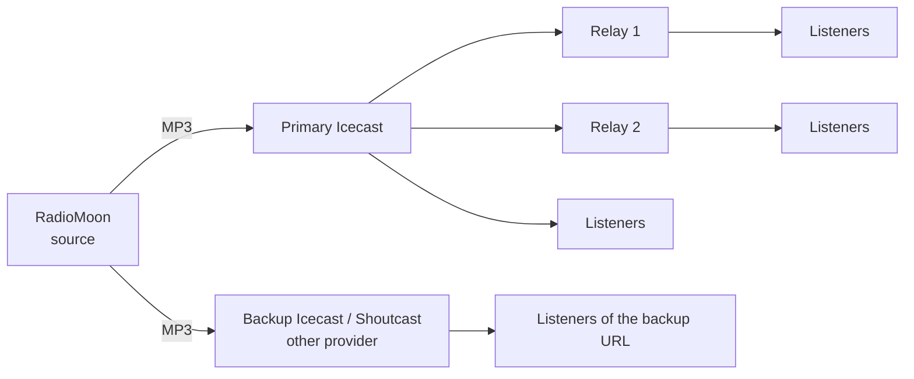

# Internet Radio Design

How the stream gets to the listeners, and how to make it robust. RadioMoon is the **source**: it sends one MP3 stream to every server you add in [[Internet Broadcast]]. The streaming server holds the listeners.

## 1. Where the listeners connect

| Design | When | How |
|---|---|---|
| **One server** | a small radio | one Icecast (or Shoutcast) entry; Icecast on the same VM or a hosted one |
| **Two servers** | the radio must not disappear if one provider fails | add **two entries** (two providers, two data centres); RadioMoon sends to both at once. Your website player uses the primary and, when it fails, the backup URL |
| **Relays** | many listeners | listeners connect to relays of the main server (Icecast `relay` / `master` setup), or to a CDN in front. RadioMoon still sends **one** stream |
| **Hosted Shoutcast + Icecast** | you want both directories and players | one entry of each type |

Every entry has its own encoder, so a second output costs CPU and upstream bandwidth: see the sizing in [[Cloud Hosting Design]].

## 2. Bitrate

MP3 48 to 320 kbps per entry. 128 kbps is the usual choice for music; 64 kbps for talk or weak mobile links; 192 to 320 kbps for quality. You can send **different bitrates to different servers**: for example 128 kbps to the main server and 64 kbps to a mobile mount.

## 3. Titles and statistics

The title of the playing song goes to every server (the "now playing" in players and directories). The number of **listeners** is read from every server every 20 seconds and the header of the studio shows the sum. Detailed statistics (countries, hours, players) come from the streaming server or a log analysis of it.

## 4. When the source stops

If RadioMoon (or the VM) stops, the listeners are disconnected or hear silence. Plan for it:

- Icecast **fallback mount**: give the main mount a fallback to a mount with a looping stream of music (a small second source, for example a playlist on a cheap machine) so listeners never get silence.
- Use the **watchdog and the service restart** of the server, and an **external monitor** on the stream URL.
- The streams marked *start automatically* connect again after a restart.

## 5. Live shows and guests

Use the **live rebroadcast** ([[Live Rebroadcast]]):

1. Give the presenter a source mount on a streaming server (`/live`), with a password; they connect from their own program (any Icecast source client).
2. Add that mount URL as a source in RadioMoon and schedule it for the time of the show, with *mute the automation*.
3. The show goes into the same stream, with the automation continuing after it.

An **audio input** (a sound card) works the same way in a studio with a mixer.

## 6. Several radios from one RadioMoon

One RadioMoon server plays **one programme**. Two programmes need two stations: see [[Hosting Several Stations]]. One programme can go to many servers.

## 7. Website and apps

Players only need the stream URL (the Icecast mount, or the Shoutcast address), plus the metadata page of the server for "now playing". Directories (TuneIn and others) take the public URL of the stream; tick *public* on the entry if you want the server to list it in its own directory.

## 8. Checklist

- [ ] Two stream servers at two providers
- [ ] The streams start automatically
- [ ] A fallback mount, or a backup stream
- [ ] HTTPS and two-step login for the studio ([[Cloud Hosting Design]])
- [ ] Backups of the database and of the `media` folder off the server
- [ ] A monitor on the stream URL and on the web studio
